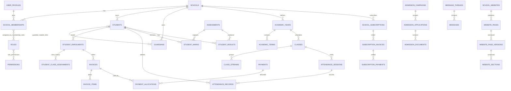

# Database Relationship Specification — v3.0

## Relationship design rules

1. Tenant-owned entities have `school_id` and are referenced with tenant-safe constraints.
2. Prefer explicit bridge/history tables for many-to-many relationships.
3. Use a foreign key with `ON DELETE RESTRICT` for records with history. Cascade only for disposable dependent configuration and only after review.
4. Auth identities are global; memberships connect identities to a school.
5. Student and staff person records are school-scoped; a person can exist in multiple schools with separately managed records.
6. Academic-year, term, class, subject, campus and student assignment relationships must be within the same tenant.
7. Public CMS publication references a version snapshot. Published content must be safe to expose independently from private records.
8. Polymorphic links require application-level type validation and cannot replace ordinary foreign keys for critical relationships.

## A. Platform and tenancy

- `schools 1—N school_campuses` (campus belongs to exactly one tenant).
- `auth.users 1—0..1 user_profiles` (profile keyed by auth user ID).
- `user_profiles 1—N school_memberships`; `schools 1—N school_memberships`. Unique active school/user membership.
- `school_memberships N—M roles` via `membership_roles`; each assignment may be scoped to campus/class/subject with a scope type and ID.
- `roles N—M permissions` via `role_permissions`. Platform role assignments are separate through `platform_roles`.
- Global role records may be shared; tenant custom roles must belong to that tenant.

## B. People and school relationships

- `schools 1—N students`; unique school/student_number.
- `schools 1—N guardians`; guardian user account is optional.
- `students N—M guardians` via `guardian_student_links`. Link carries relationship, verification, legal authority, contact and portal permission flags; it is the gate for guardian access.
- `students 1—N student_enrolments`; enrolment references one academic year and grade, optionally class/stream.
- `students 1—N student_class_assignments` through enrolment history; each assignment references a class and optional stream.
- `schools 1—N staff`; staff may link to a user account.
- `staff 1—N staff_employment`, qualifications and documents; employment rows track history.
- `staff N—M staff_departments` through staff_department_memberships.
- `staff 1—N teacher_assignments`; teacher assignment points to class, optionally subject, and academic year.

## C. Academics

- `schools 1—N academic_years`; year contains terms (`academic_years 1—N academic_terms`).
- `schools 1—N grade_levels`; each class references a grade level and year.
- `academic_years 1—N classes`; `grade_levels 1—N classes`; campus optional.
- `classes 1—N class_streams`.
- `subjects 1—N class_subjects`; class, subject and year are linked through class_subjects, which may include stream and teacher.
- `student_enrolments 1—N student_class_assignments`; assignments record class/stream history.
- `grading_schemes 1—N grading_scale_items`; schemes may be scoped by grade, subject and academic year.

## D. Attendance

- `classes 1—N attendance_sessions`; a session belongs to school/year and optionally term/stream/period.
- `attendance_sessions 1—N attendance_records`; each record is for one student; unique session/student.
- `attendance_records 1—N attendance_corrections`; corrections append and include review.
- `attendance_records 1—N attendance_notifications`; guardian notifications may have delivery attempts.
- Ensure the student was enrolled and in the session's class/stream on the session date; validate with a transaction or controlled service.

## E. Assessment and reporting

- `academic_years 1—N assessment_periods`; period may link to term.
- `assessment_periods 1—N assessments`; each assessment links to one class_subject.
- `assessments 1—N assessment_components` (optional components).
- `assessments 1—N student_marks`; marks keyed by student and component; component may be null for whole assessment.
- `student_marks 1—N mark_moderation`; moderation history append-only.
- `assessments 1—N student_results`; result is one per student/assessment.
- `student_enrolments 1—N report_cards`; report card has one year/term and type.
- `report_cards 1—N report_card_items`; items link subjects and snapshot the grade/comment summary.
- Result/mark student eligibility must be checked against class subject assignment at the assessment date.

## F. Admissions

- `admission_campaigns 1—N admission_applications`; campaign targets year and optionally grade.
- `admission_applications 1—N admission_applicants, admission_guardians, admission_documents, admission_reviews, admission_interviews, admission_offers, admission_status_history, admission_payments`.
- `admission_applications 0..1—1 students` after authorised conversion (application's converted_student_id); conversion should be transactional and idempotent.
- Campaign fee settings and payments reference the campaign/application; admission payment should not be confused with school fee payment.

## G. School finance

- `fee_categories 1—N fee_structure_items`.
- `academic_years 1—N fee_structures`; structures may target grade.
- `fee_structures 1—N fee_structure_items`.
- `student_enrolments 1—N fee_assignments`; each assignment references one structure.
- `student_enrolments 1—N invoices`; invoice contains line snapshots (`invoices 1—N invoice_items`).
- `payments 1—N payment_allocations`; `invoices 1—N payment_allocations`. This bridge allows partial payments and payments allocated across invoices. Unallocated credit is tracked separately.
- `payments 0..N receipts` (receipt issuance/void history may require more than one record; policy decides unique active receipt).
- `payments 1—N refunds`; refund approval rows attach to refund.
- Invoice credit notes/adjustments attach to invoice; no deletion of posted items.
- Bank account has imports; import has statement entries; reconciliation matches one or more statement entries to payment/journal lines using explicit matching groups where split matches are supported.
- Chart accounts form parent/child hierarchy. Accounting period contains journals; journal has lines; line references one account.
- Expenses reference category, optional supplier/period; category may map to chart account. Purchase request may reference supplier; budget belongs to period and has budget items by account.
- Financial approvals reference a typed subject; application validates subject exists and tenant matches.

## H. Websites, CMS and domains

- `school_websites 1—N website_pages`; page can have parent page for hierarchy.
- `website_pages 1—N website_page_versions`; version is immutable content snapshot.
- `website_page_versions 1—N website_sections`; section records ordered component and validated props.
- `website_components` supplies allow-listed component schema.
- `website_pages 1—N website_publications`; publication event references exact page version.
- `website_websites 1—N website_domains` (correct canonical table is `school_websites 1—N website_domains`). One verified primary domain per website; domains globally unique after normalisation.
- Website media references files; articles/events/forms belong to website. Article featured media optional.
- Translations reference the source page identity and target locale; publishing references approved translation/version.
- Navigation, SEO and form schemas are website-scoped configuration; submissions are tenant data and may contain sensitive information.

## I. Portals and communication

- `user_profiles 1—N portal_preferences, portal_notifications, portal_access_logs, portal_device_tokens, notification_preferences` within tenant scope.
- Announcements target audience via explicit validated scope; where delivery needs durable recipient list, materialise recipients separately (future table recommendation: `announcement_recipients`).
- `message_threads 1—N messages`; thread participants through message_recipients; attachments reference files.
- Notification templates feed delivery records; provider logs map external events to deliveries. Delivery status updates are event-driven and deduplicated.

## J. Additional services

- `library_categories 1—N library_books`; books have copies. Copies have loan history; loans have optional fine records; reservations are for title/book and fulfilled by a copy.
- `transport_routes 1—N transport_route_stops`; each row references a stop and sequence. Route optionally uses vehicle and driver. Students' enrolments have route assignments to a stop on the route.
- Transport incidents may reference route/vehicle/student but remain restricted.
- Document categories group documents; document versions reference files; document permissions grant scoped access; access logs record use; retention rules govern expiry.
- Support tickets have messages, assignments, attachments and status history. Internal ticket messages are not visible to requester.

## K. XEN SaaS commercial billing

- `subscription_plans 1—N subscription_features`.
- `schools 1—N school_subscriptions`; subscription references plan and preserves history.
- `school_subscriptions 1—N subscription_items, subscription_invoices, subscription_events`.
- `subscription_invoices 1—N subscription_payments`.
- `schools 1—N usage_records, billing_customers`.
- Promotion codes require a redemption/usage table before production use (recommended `promotion_redemptions` with school/subscription/invoice and unique redemption key).

## L. Audit and storage

- Audit logs and security events may be platform-level (school_id null) or tenant-scoped.
- System jobs have job failures; webhook logs deduplicate provider events.
- Data export/deletion requests are school-scoped and subject-verified; consent records use typed subject references with application validation.
- File metadata is central. Domain tables point to files through ordinary FKs. Object key uniqueness and tenant/private access policies are enforced.

## Relationship diagram — conceptual overview

This diagram is deliberately simplified; the field-level FK mapping and constraints in this document govern implementation.
