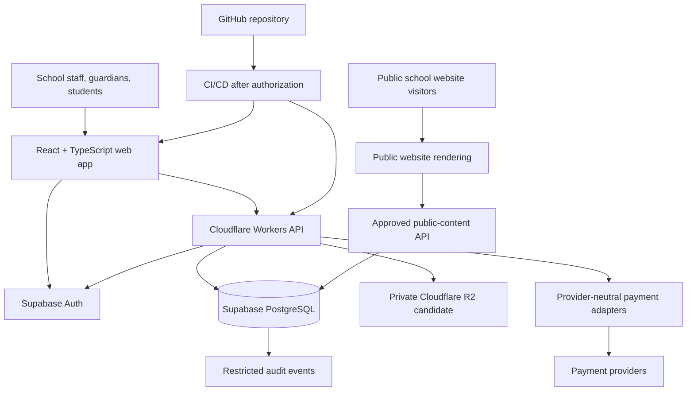

# Technical Architecture Baseline — XEN SCHOOL MANAGEMENT v3.0

**Status:** Owner-approved architecture baseline (20 November 2026); a live bootstrap has since been started as recorded in live-project-bootstrap-status.md. Provider, legal, operational and security verification gates remain open. This baseline does not authorize further implementation.

## 1. Purpose
This document records the agreed architecture direction for XEN SCHOOL MANAGEMENT v3.0. It translates approved product/design decisions and the Technical Decision Register into a baseline for detailed design and migration readiness.

## 2. Architecture overview

## 3. Approved technology baseline

| Layer | Baseline | Design notes |
|---|---|---|
| Web frontend | React + TypeScript | Responsive staff, guardian, student and admin experiences |
| Frontend hosting | Vercel | Separate preview/staging/production configuration |
| Backend/API | Cloudflare Workers | API-first for core/sensitive actions, validation, authorization, rate limiting and integrations |
| Database | Supabase PostgreSQL | Relational integrity; private domain schemas; RLS |
| Authentication | Supabase Auth | Auth UUID linked to app identity; memberships/roles stored separately |
| File/object storage | Private Cloudflare R2 candidate | Quarantine, scanning, metadata, signed access; provider verification required |
| Source control | GitHub | Reviewable docs, code and migrations |
| Migration tool | Supabase CLI | Ordered SQL migrations, locally replayable and tested |
| Testing | Unit/integration/security + browser acceptance | Exact tooling versions chosen during implementation |
| Observability | Provider logs/metrics plus application audit | Define retention, alerts, privacy and cost before launch |

## 4. Logical domain boundaries
Use clear database namespaces/schemas or controlled domain groupings. Proposed domains:
- **platform:** tenants/schools, memberships, roles, permissions, subscription/tenant settings.
- **school_core:** people, students, guardians, staff, verified relationships, enrolments.
- **academics:** campuses, calendars, academic years/terms, classes, subjects, attendance, assessment, results, report cards, admissions.
- **school_finance:** fees, invoices, payments, allocations, receipts, accounting and ledger.
- **cms_private:** website configuration, authoring, drafts, media metadata, review and publication records.
- **communications:** messaging, notifications, templates, preferences, moderation, delivery/read states.
- **restricted:** health and safeguarding; restricted grants and audit.
- **xen_billing:** XEN subscriptions, plans, usage, entitlements, invoices and platform payments.
- **operations:** support, jobs, webhooks, exports, audit metadata and platform operations.

Domain separation is logical and does not replace grants, authorization or RLS. Restricted schemas must not be exposed to anonymous or ordinary browser roles.

## 5. Request and authorization pattern
1. Authenticate the user with Supabase Auth.
2. Client may select a school/campus context, but the API resolves and validates active membership from the authenticated subject.
3. API validates input, checks permission and tenant context, applies rate limits and idempotency where relevant.
4. Database operations run with a least-privilege identity and tenant context; RLS is enforced as defence in depth.
5. Sensitive actions are audited without unnecessarily copying personal/sensitive payloads.
6. Return only the minimum data required by the role and operation.

No privileged database/service credentials may reach browser code. Client-provided tenant IDs or role labels are never authoritative.

## 6. Public website boundary
School CMS authoring and drafts remain private. Publishing requires explicit review/approval and creates a version/publication record. Public website reads use a dedicated safe projection/API that exposes only approved published content and approved public media for a verified domain. Unpublishing must invalidate relevant cache. Public routes must not join or expose student/guardian, attendance, results, finance, health or safeguarding data.

## 7. Financial and payment architecture
- School finance and XEN SaaS billing are separate domains, permissions, record lifecycles and reporting.
- Posted ledger entries are immutable. Corrections use reversals/adjustments.
- Store monetary amounts as integer minor units plus currency code and currency-specific precision. Never assume every currency has two decimal places.
- Conversion records retain source and target amounts/currencies, rate, source and timestamp.
- Payment integration uses provider-neutral adapters. Server-side verification, idempotency, webhook authentication, reconciliation, refund/chargeback state and audit are required. Provider selection remains a verification task.

## 8. File handling
Files are private by default. The upload lifecycle is:
1. Create authorized metadata record and upload intent.
2. Upload to quarantine.
3. Validate size, type and content; scan for malware.
4. Mark clean only after verification.
5. Authorize each access and serve through short-lived signed URL or Worker-mediated delivery.
6. Track retention, deletion, backup and legal hold where applicable.
7. Public assets require explicit publication, rights and consent checks.

Object keys must not contain names, student numbers or other personal data.

## 9. Tenant isolation and database security
- Active tenant context is derived from authenticated identity and membership; a tenant ID from the client is only a selector.
- RLS is mandatory and fail-closed, including cross-tenant tests for every domain.
- RLS helper functions use safe search_path, fully qualified objects and least privilege. Avoid SECURITY DEFINER unless documented and security-reviewed.
- Keep private/restricted schemas out of browser-facing API exposure.
- Review database grants, exposed views/RPC, service credentials and privileged functions.
- Membership revocation must be immediate or have a documented cache expiry/invalidation strategy.

## 10. Time, currency and localization
- Use timestamptz for instants and UTC storage; date for date-only facts.
- Store IANA timezone settings (school/campus/user as relevant).
- Currency uses currency code and currency-specific precision. Conversions are explicit and auditable.
- Locale, language, date/number formatting and school configuration must be designed for Zimbabwe-first and international expansion. Do not hardcode country, currency, timezone or grading system as a global assumption.

## 11. Privacy, audit and recovery
Maintain data inventory and lawful purpose/basis, consent where required, access/correction, retention, export, deletion/anonymization, legal holds, incident response and vendor review. Children's and health/safeguarding data require heightened controls and jurisdiction-specific review. Audit records are append-only and access-restricted.

Before production, define per-domain RPO/RTO, backup cadence/retention, PITR capability, independent encrypted backup, key custody and restoration drills. Recovery must consider database, auth, object storage, DNS, secrets and application compatibility.

## 12. Environment and delivery model
- Local development uses synthetic data and a local/test database.
- Staging is isolated from production and uses no production personal data.
- Production secrets are managed server-side and never committed or embedded in frontend.
- Migrations are versioned in Git, reviewed, replayed from an empty database and applied through controlled release steps.
- CI/CD, hosting and infrastructure configuration are not to be implemented until the owner separately authorizes implementation.
- Release process must include backup/restore plan, rollback or forward-fix plan, smoke tests, monitoring and change approval.

## 13. Required pre-production verification
- [ ] Confirm Supabase region/tier, version, extensions, pooling, backup/PITR, cost and latency.
- [ ] Complete legal/privacy review for child data, residency, retention, consent, school contracts and deletion/export.
- [ ] Define RPO/RTO by domain and complete a restoration drill.
- [ ] Verify R2/storage choice, cost, scanning, signed access, lifecycle and backup.
- [ ] Select payment providers after market/legal review; test sandbox and verified callbacks.
- [ ] Verify custom-domain ownership, tenant routing, SSL and cache invalidation.
- [ ] Review grants, RLS, exposed schemas/views/RPC and tenant-isolation threat model.
- [ ] Confirm plan limits, costs, observability, secrets, support and incident escalation.
- [ ] Approve migration implementation plan and rollback strategy.
- [ ] Obtain separate implementation authorization.

## 14. Implementation boundary
This architecture baseline does not create or authorize further executable SQL, migration files, seed data, application code, CI workflows, infrastructure, or deployment. Existing bootstrap artifacts and the live database must be reconciled to the target blueprint. The next planning stage is baseline/replay validation and a pre-implementation readiness/sign-off package.